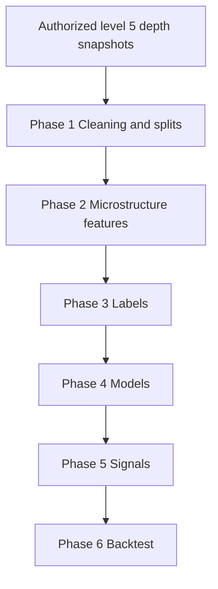

# Reliance Strategy Experiments

RELIANCE market-depth research covering data cleaning, microstructure features, labels, predictive models, signals and historical backtests.

## Research workflow



The diagram describes the research components, not verified performance or an automated live-trading service.

## Setup

Use Python 3.10 or newer for modern source syntax. Dependencies are inferred from the included source and are not a tested version lock.

```powershell
python -m venv .venv
.venv\Scripts\python -m pip install -r requirements.txt
```

On macOS/Linux use `.venv/bin/python`. Review local input paths before running scripts; some scripts perform work at import time. Clean installation and full experiments have not been verified for this release.

## Data and run order

Supply authorized one-second depth CSVs under `input/` with names matching `reliance_depth_YYYYMMDD_HHMMSS.csv`. Phase 1 expects 42 columns: timestamp, five bid triplets, five ask triplets and eleven trailing quote/status fields. Column order is significant; inspect `phase1_ingest.py` for the exact mapping and validation rules.

Run the six phase scripts in numerical order from the repository root after preparing inputs: `phase1_ingest.py`, `phase2_features.py`, `phase3_labels.py`, `phase4_model.py`, `phase5_signals.py`, `phase6_backtest.py`. Outputs are created under local output, reports and model directories. Later phases require earlier generated artifacts.

`fetch_reliance_orderbook.py` is an optional broker-connected data collector using ICICI environment variables. It was not run during publication. The blank `.env.example` lists the expected variables. Review provider permissions and API behavior before using it. `convert_tsv_to_csv.py` is a conversion helper; check its input paths before running.

The original live demo and all local Git history are intentionally outside this research release.

## Source guide

| File | Purpose from source documentation |
|---|---|
| `convert_tsv_to_csv.py` | Research utility; inspect inputs and configuration in the source. |
| `fetch_reliance_orderbook.py` | reliance_market_depth_updated.py |
| `phase1_ingest.py` | Research utility; inspect inputs and configuration in the source. |
| `phase2_features.py` | Research utility; inspect inputs and configuration in the source. |
| `phase3_labels.py` | Research utility; inspect inputs and configuration in the source. |
| `phase4_model.py` | Research utility; inspect inputs and configuration in the source. |
| `phase5_signals.py` | Research utility; inspect inputs and configuration in the source. |
| `phase6_backtest.py` | Research utility; inspect inputs and configuration in the source. |

## Security and publication scope

Only explicitly selected research source and newly prepared documentation are published. Populated environment files, sessions, private keys, account state, raw data, model binaries, historical outputs, paper PDFs, caches and local Git history are excluded. Original local project files are unchanged. Do not publish generated output without checking it for personal information and data redistribution rights.

Selected Python source passed syntax checks. Selected text was screened for credential patterns and known local credential values. These checks are not a security certification; dependency vulnerabilities, full execution and broker integration were not tested. No live orders or broker login were performed.

## Research limitations

No historical performance headline is asserted or independently reproduced here. Review sample selection, holdout reuse, look-ahead risk, costs, spread, slippage and sizing before interpreting results. Source comments reflect the original experiments and are not independently verified claims. Research output does not establish deployment readiness.

## License

No open-source license has been assigned. Public visibility alone does not grant general reuse or redistribution rights.
